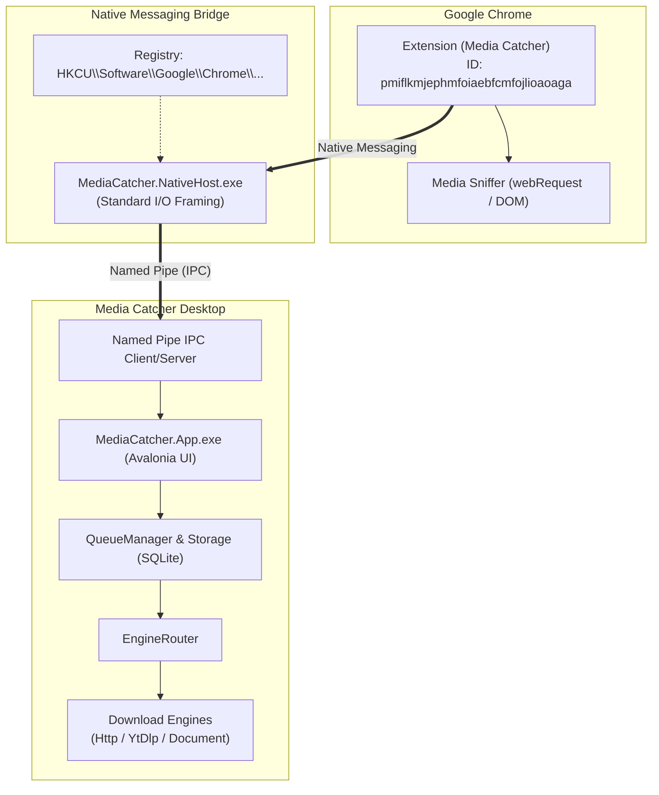

# คู่มือการติดตั้งและใช้งาน Media Catcher บน Google Chrome

เอกสารฉบับนี้อธิบายขั้นตอนการติดตั้ง การเชื่อมต่อ และการทดสอบ **Media Catcher** ร่วมกับเว็บเบราว์เซอร์ **Google Chrome** บนระบบปฏิบัติการ Windows

---

## 1. ข้อมูลระบบที่กำหนดไว้ล่วงหน้า (Pre-configured Settings)

Extension ID ถูกปักหมุด (pin) ผ่าน `key` ใน `manifest.json` แล้ว ทำให้ ID คงที่ถาวรไม่ว่าจะโหลดจากโฟลเดอร์ใด:

| รายการ | ค่าที่กำหนด | คำอธิบาย |
| :--- | :--- | :--- |
| **Extension ID** | `pmiflkmjephmfoiaebfcmfojlioaoaga` | ปักหมุดผ่าน `key` ใน `manifest.json` (คงที่ถาวร) |
| **Native Host Name** | `com.mediacatcher.host` | ชื่อ Host สำหรับการสื่อสารแบบ Native Messaging |
| **Host Registry Key** | `HKCU:\Software\Google\Chrome\NativeMessagingHosts\com.mediacatcher.host` | ตำแหน่งใน Windows Registry |
| **Host Manifest Path** | `%LOCALAPPDATA%\MediaCatcher\com.mediacatcher.host.json` | ไฟล์การตั้งค่า Host ที่ Chrome ใช้อ้างอิง |
| **Host Executable** | `MediaCatcher.NativeHost.exe` | ตัวกลางเชื่อมต่อระหว่าง Chrome กับแอปพลิเคชัน |

---

## 2. แผนผังสถาปัตยกรรมการเชื่อมต่อ (Architecture Flow)



---

## 3. ขั้นตอนการติดตั้งบน Google Chrome (ทำเพียงครั้งเดียว)

### ขั้นตอนที่ 1: ติดตั้ง Extension บน Chrome
1. เปิด **Google Chrome**
2. ไปที่หน้าจัดการส่วนขยายโดยพิมพ์ในช่อง Address bar:
   ```text
   chrome://extensions
   ```
3. เปิดสวิตช์ **Developer mode** (โหมดนักพัฒนา) ที่มุมบนขวา
4. คลิกปุ่ม **Load unpacked** (โหลดส่วนขยายที่แยกไฟล์ไว้) ที่มุมบนซ้าย
5. เลือกโฟลเดอร์ส่วนขยาย:
   ```text
   D:\Mediafire\Mediafire\Programs\MediaCatcher\extension
   ```
6. สังเกตการ์ดส่วนขยายจะแสดงชื่อ **Media Catcher** พร้อม ID:
   ```text
   pmiflkmjephmfoiaebfcmfojlioaoaga
   ```
7. ปิด Google Chrome แล้วเปิดใหม่อีกครั้ง เพื่อให้เบราว์เซอร์โหลดการเชื่อมต่อ Native Messaging Host

### ขั้นตอนที่ 2: ลงทะเบียน Native Messaging Host
เปิด PowerShell แล้วรัน:
```powershell
powershell -ExecutionPolicy Bypass -File scripts\register-native-host.ps1 -ExtensionId "pmiflkmjephmfoiaebfcmfojlioaoaga"
```
จากนั้นปิด Google Chrome ทั้งหมดแล้วเปิดใหม่อีกครั้ง

---

## 4. การเปิดใช้งานและทดสอบการดาวน์โหลด

### การรันแอปพลิเคชันหลัก
เปิด PowerShell แล้วรันคำสั่ง:
```powershell
dotnet run --project src\MediaCatcher.App\MediaCatcher.App.csproj
```
หรือดับเบิลคลิกไฟล์:
```text
D:\Mediafire\Mediafire\Programs\MediaCatcher\src\MediaCatcher.App\bin\Debug\net10.0-windows\MediaCatcher.App.exe
```

### การทดสอบดักจับสื่อบนหน้าเว็บ
1. คลิกที่ไอคอน **Extensions (รูปจิ๊กซอว์)** บนแถบเครื่องมือของ Chrome แล้วกด **ปักหมุด (Pin)** ไอคอน Media Catcher
2. เปิดเว็บไซต์ที่มีไฟล์มีเดีย เช่น:
   - วิดีโอสตรีมมิ่ง (YouTube, Vimeo, หน้าเว็บข่าวทั่วไป)
   - ไฟล์เสียง หรือ พ็อดคาสต์
   - เอกสาร Flipbook (Anyflip, FlipHTML5)
   - ไฟล์ดาวน์โหลดตรง (Direct Links: `.mp4`, `.zip`, `.pdf`)
3. เมื่อหน้าเว็บโหลดสื่อ ไอคอน Media Catcher จะแสดงตัวเลขจำนวนไฟล์ที่ตรวจพบ
4. คลิกที่ไอคอนเพื่อเปิด Popup เลือกระดับความละเอียด/รูปแบบ แล้วกดปุ่ม **Download**
5. งานดาวน์โหลดจะถูกส่งเข้าไปประมวลผลในคิวของแอป **Media Catcher** ทันที

---

## 5. การตรวจสอบความเรียบร้อยและแก้ไขปัญหา (Troubleshooting)

### ตรวจสอบความถูกต้องของ Native Messaging Host
สามารถตรวจสอบไฟล์ Manifest ของ Native Host ได้จาก:
```powershell
Get-Content "$env:LOCALAPPDATA\MediaCatcher\com.mediacatcher.host.json"
```
เนื้อหาที่ถูกต้องต้องระบุ `path` ไปยัง `MediaCatcher.NativeHost.exe` และระบุ `allowed_origins` ตรงกับ Extension ID:
```json
{
  "name": "com.mediacatcher.host",
  "description": "Media Catcher Native Messaging Host",
  "path": "D:\\Mediafire\\Mediafire\\Programs\\MediaCatcher\\src\\MediaCatcher.NativeHost\\bin\\Debug\\net10.0-windows\\MediaCatcher.NativeHost.exe",
  "type": "stdio",
  "allowed_origins": [
    "chrome-extension://pmiflkmjephmfoiaebfcmfojlioaoaga/",
    "edge-extension://pmiflkmjephmfoiaebfcmfojlioaoaga/"
  ]
}
```

### หากส่วนขยายขึ้นแจ้งเตือนว่า "Host not found" หรือไม่ตอบสนอง
1. ตรวจสอบว่าโปรแกรม `MediaCatcher.App.exe` เปิดทำงานอยู่หรือไม่
2. ลองปิด Google Chrome ทั้งหมดผ่าน Task Manager แล้วเปิดใหม่
3. ในหน้า `chrome://extensions` กดปุ่มรีโหลด (ลูกศรวน) ที่การ์ด Media Catcher
